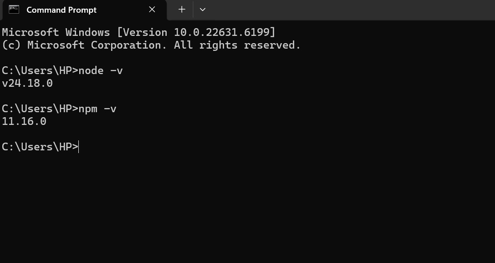
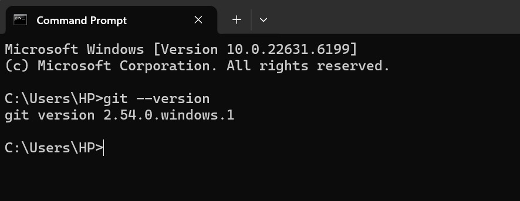
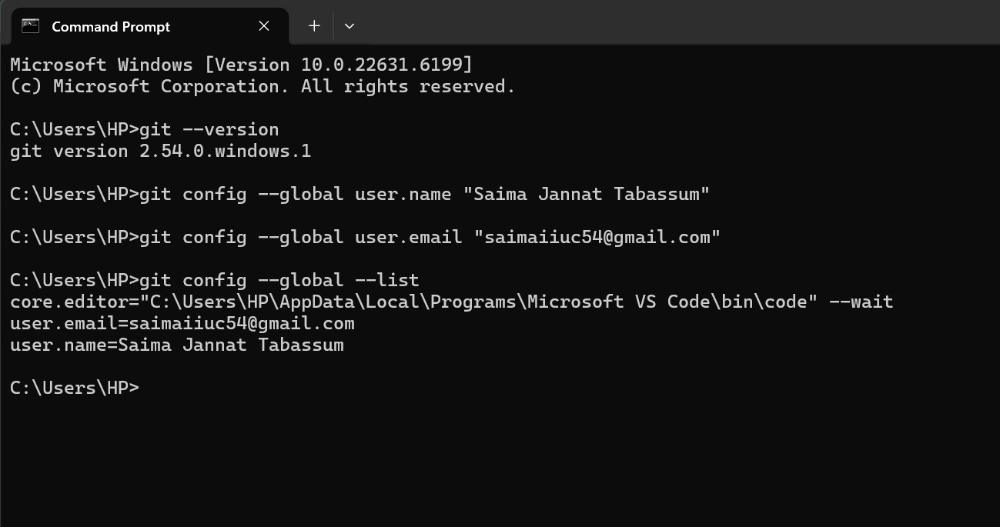

# Task 1: Setup Development Environment

## Installed Tools
| Tool | Version |
|------|---------|
| Node.js | v24.18.0 |
| npm | 11.16.0 |
| Git | 2.54.0.windows.1 |
| VS Code | 1.146.0 |
| Database | __ |
## Screenshots
### Node.js and npm

### Git version

### Git setup

## Git Commands Practiced
`git init`, `git clone`, `git status`, `git add`, `git commit`, `git push`, `git pull`, `git branch`, `git checkout -b`, `git log`

## Terminal Commands Practiced
`pwd`, `ls`, `cd`, `mkdir`, `touch`, `rm`, `cp`, `mv`, `cat`, `clear`