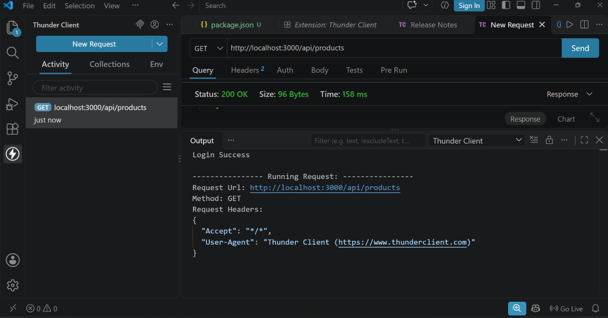
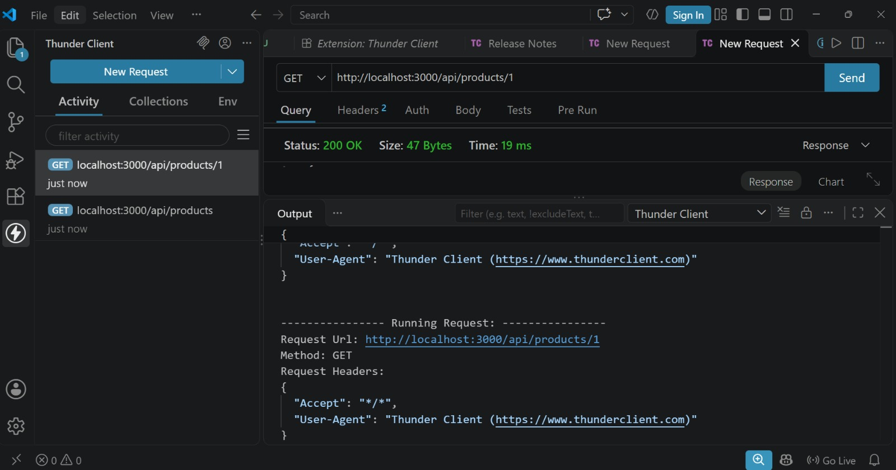
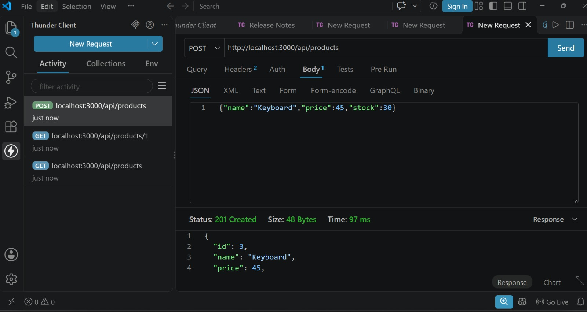
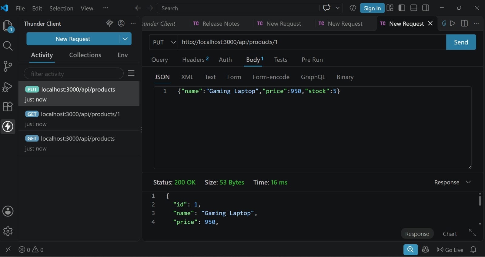
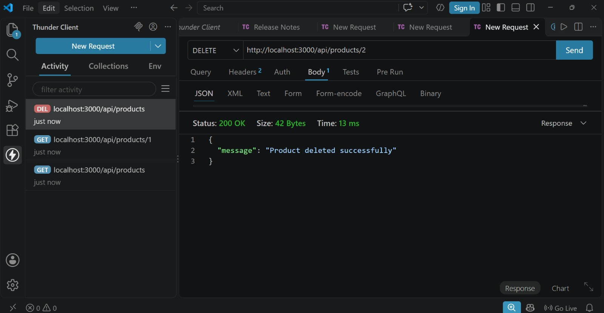
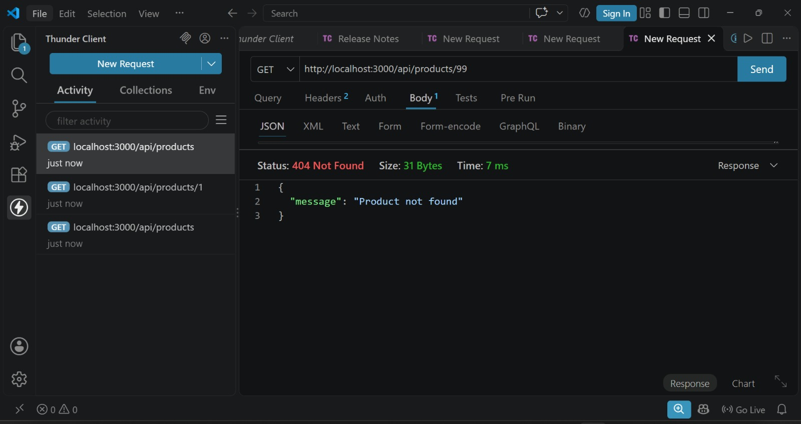
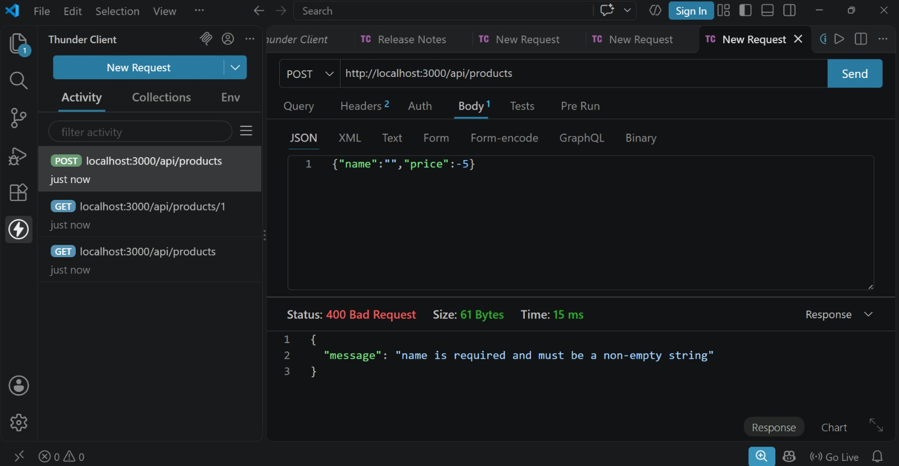

# Task 2: Simple REST API (Node.js + Express)

A simple REST API with CRUD operations on a `products` resource. Data is stored in memory, so it resets when the server restarts.

## Setup
    npm install
    npm run dev

Server runs on http://localhost:3000

## Endpoints
| Method | Endpoint | Description |
|--------|----------|-------------|
| GET | /api/products | Get all products |
| GET | /api/products/:id | Get one product |
| POST | /api/products | Create a product |
| PUT | /api/products/:id | Update a product |
| DELETE | /api/products/:id | Delete a product |

## Error Handling
- 400: invalid input (validation error, invalid JSON)
- 404: product or route not found
- 500: internal server error

## Testing with Thunder Client

### GET all products

### GET one product

### POST (create)

### PUT (update)

### DELETE

### Not found (404)

### Validation error (400)

