# Level 2, Task 2: Authentication and Authorization

Express + PostgreSQL API with user signup and login using bcrypt and JWT, protected routes, and role-based access (`user` and `admin`).

## Features
- Signup with validation (valid email, unique email, password of at least 6 characters)
- Passwords are hashed with bcrypt before they are saved
- Login returns a JWT stored in an HTTP-only cookie (it can't be read by JavaScript in the browser)
- `Authorization: Bearer <token>` is also accepted
- Protected routes return 401 without a valid token
- Role-based access: any logged-in user can read products, only `admin` can create, update or delete
- New signups always get the `user` role. An admin account is created from `.env` on first start

## Setup
1. Create a PostgreSQL database named `codveda_db`
2. Copy `.env.example` to `.env` and fill in the values (database user and password, `JWT_SECRET`, admin email and password)
3. Install and run:

        npm install
        npm run dev

Server runs on http://localhost:5000

## Endpoints
| Method | Endpoint | Access | Description |
|--------|----------|--------|-------------|
| POST | /api/auth/signup | public | Create an account |
| POST | /api/auth/login | public | Log in, sets the token cookie |
| POST | /api/auth/logout | public | Clears the cookie |
| GET | /api/auth/me | logged in | Current user |
| GET | /api/users | admin | List users |
| PUT | /api/users/:id/role | admin | Change a user's role |
| GET | /api/categories | logged in | List categories |
| POST | /api/categories | admin | Create a category |
| GET | /api/products, /api/products/:id | logged in | Read products |
| POST, PUT, DELETE | /api/products | admin | Create, update, delete products |

## Status codes
- 201 created, 200 success
- 400 validation error or duplicate email
- 401 missing, invalid or expired token, or wrong login
- 403 logged in but not allowed (wrong role)
- 404 not found

## Password hashing proof
Passwords are stored as bcrypt hashes, never as plain text.
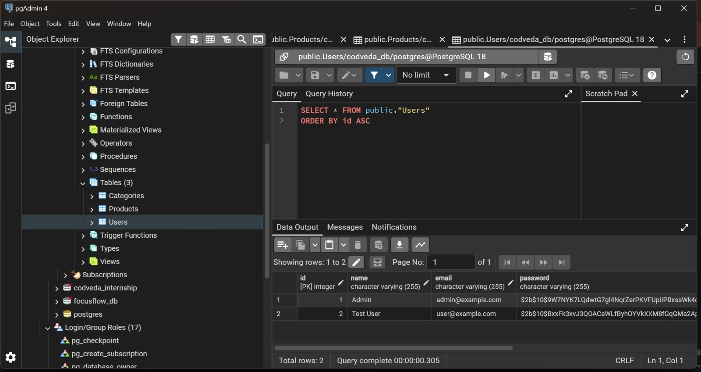

## API Testing (Thunder Client)

### Signup
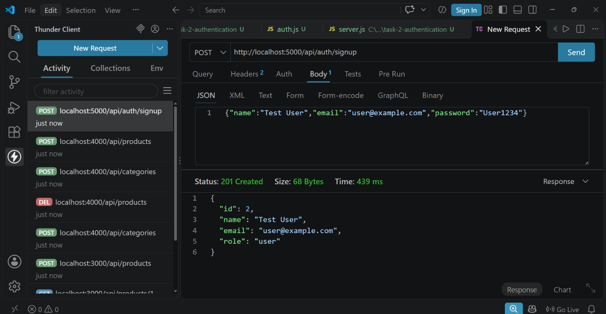

### Validation errors
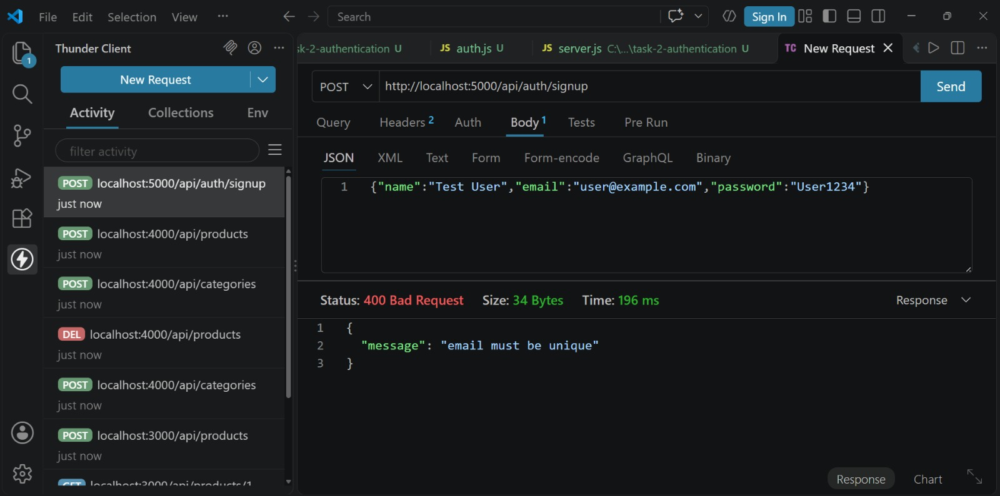
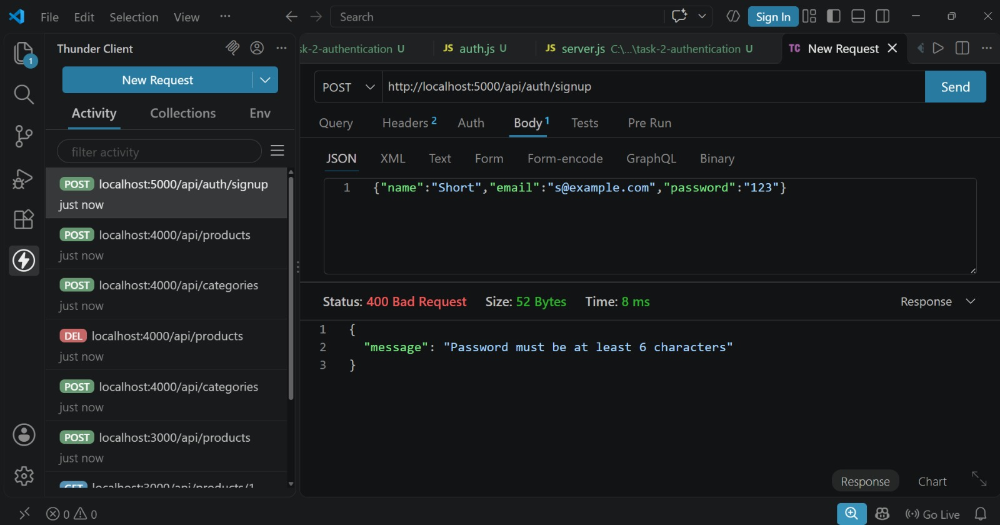

### Protected route without a token (401)
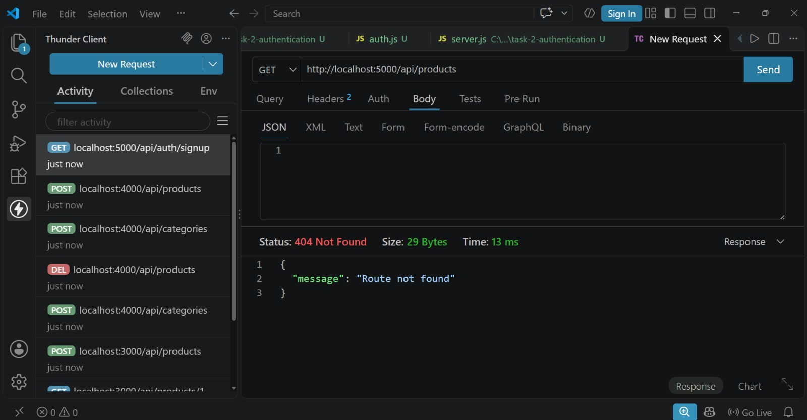

### Login
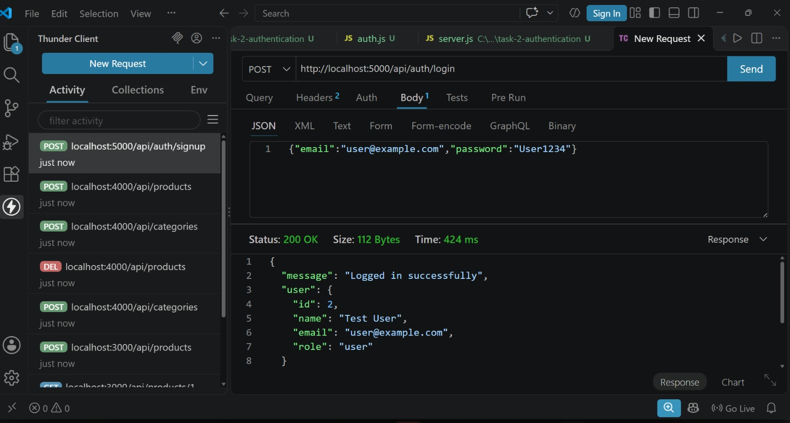
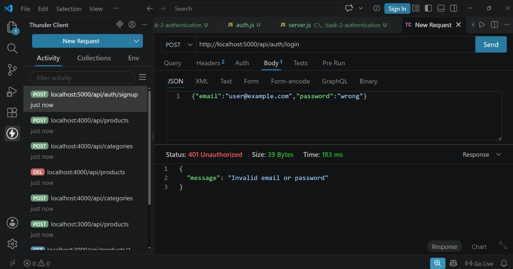

### Current user and read access
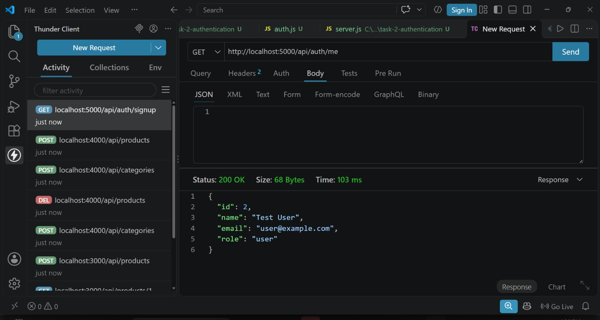
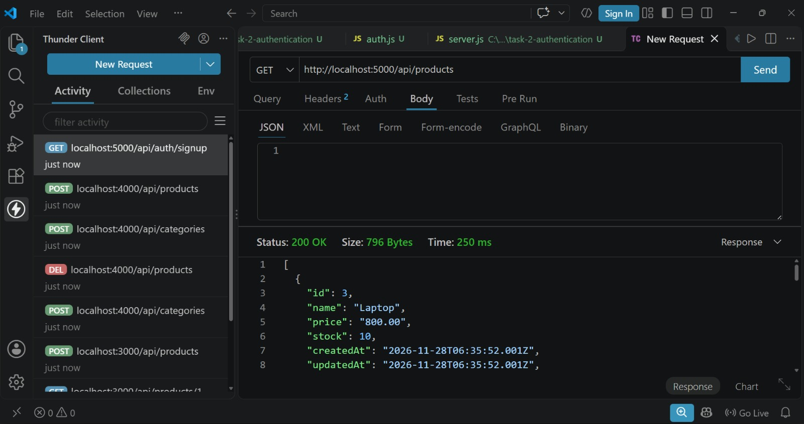

### Role-based access
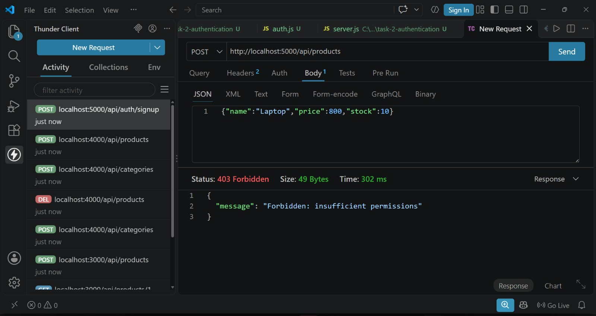
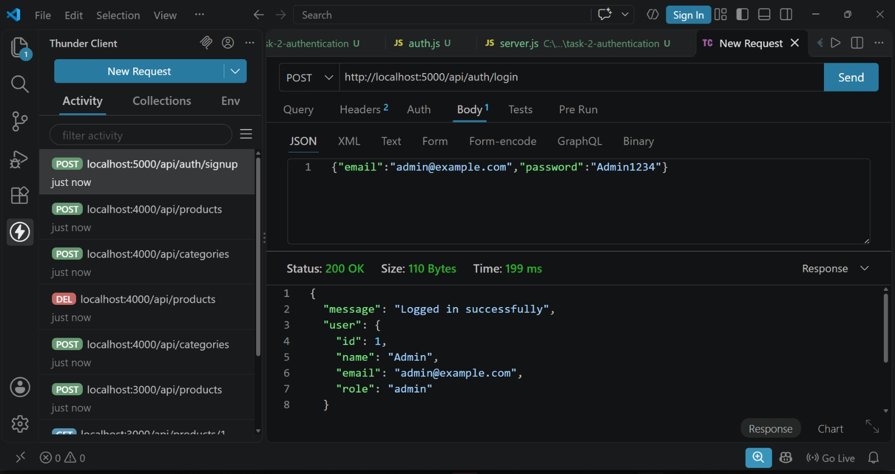
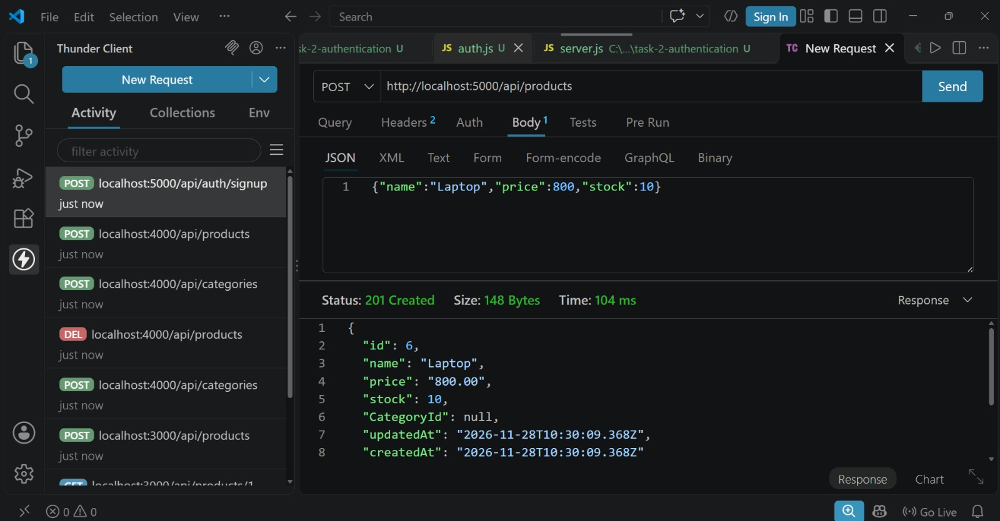

### Logout
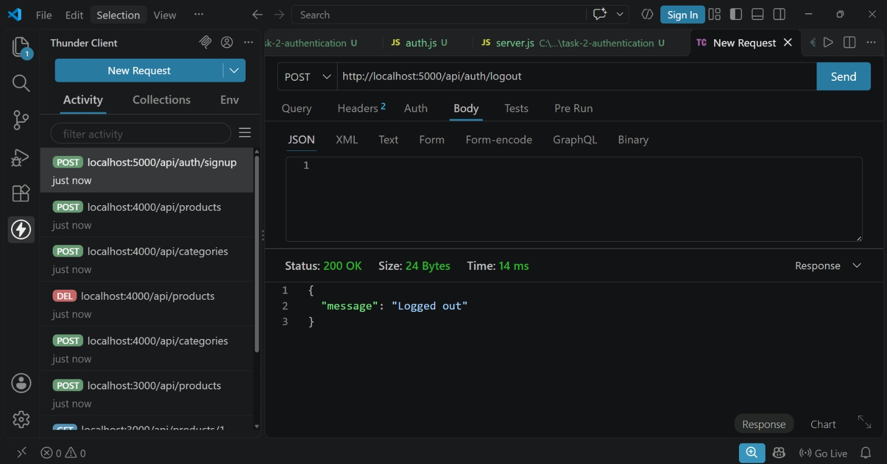