# Level 2, Task 3: Database Integration (PostgreSQL + Sequelize)

REST API for products and categories, backed by a PostgreSQL database using the Sequelize ORM.

## Features
- PostgreSQL with Sequelize ORM
- Two models, `Category` and `Product`, with a one-to-many relationship (a category has many products)
- Indexes on `Product.name` and `Product.price`
- Validation before saving records
- Full CRUD for products, create and list for categories

## Setup
1. Create a PostgreSQL database named `codveda_db`
2. Copy `.env.example` to `.env` and fill in your database user and password
3. Install and run:

        npm install
        npm run dev

Server runs on http://localhost:4000

## Endpoints
| Method | Endpoint | Description |
|--------|----------|-------------|
| GET | /api/categories | List categories |
| POST | /api/categories | Create a category |
| GET | /api/products | List products with their category |
| GET | /api/products/:id | Get one product |
| POST | /api/products | Create a product |
| PUT | /api/products/:id | Update a product |
| DELETE | /api/products/:id | Delete a product |

## Validation rules
- Product name: required, 2-100 characters
- Price: required, 0 or more
- Stock: integer, 0 or more
- Category name: required, unique, 2-50 characters
- Invalid `CategoryId` returns 400, unknown product id returns 404

## Database

### Categories table (unique name)
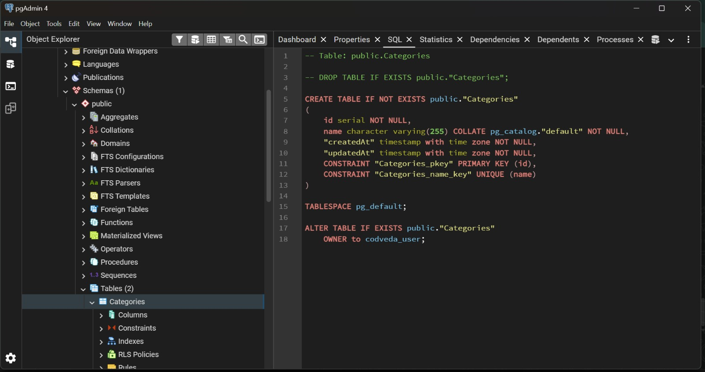

### Products table (foreign key to Categories, ON DELETE SET NULL)
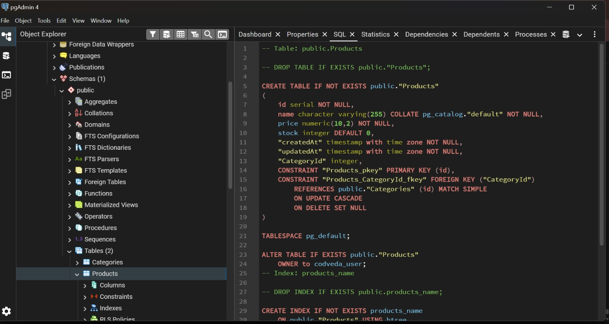

### Indexes on Products
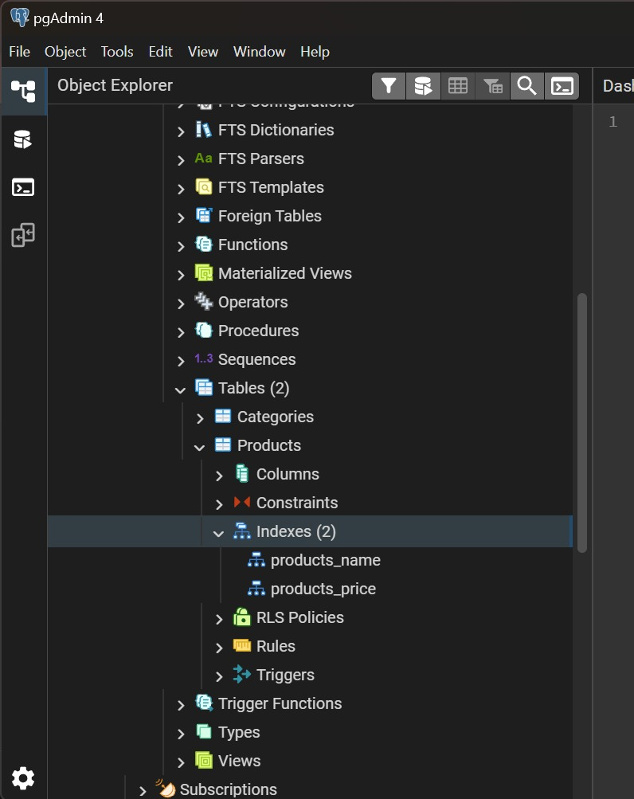

### Stored data
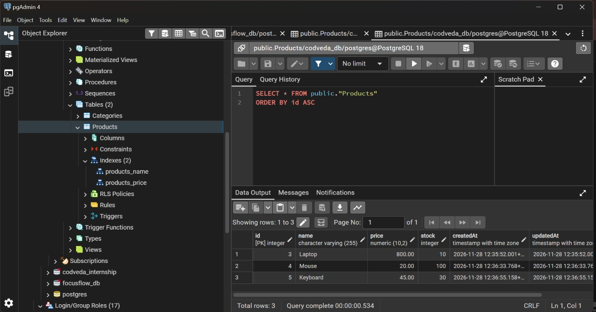

## API Testing (Thunder Client)

### Create category
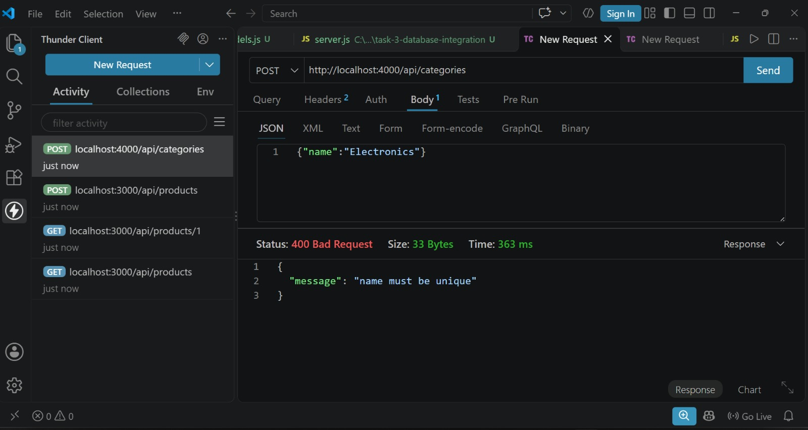

### Create product
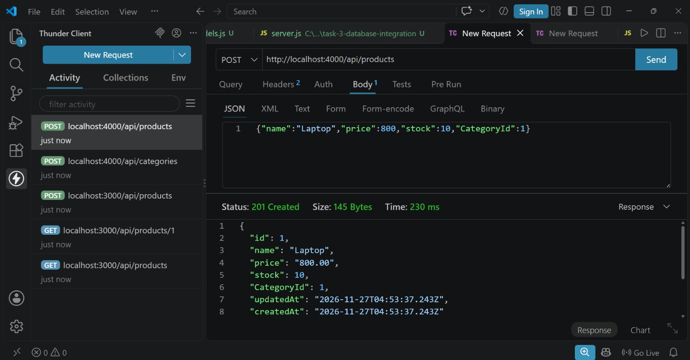

### Get all products with category
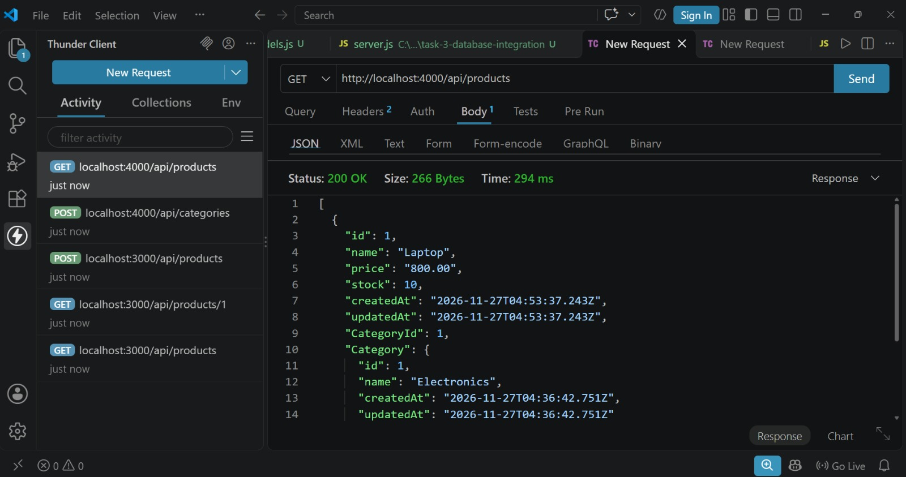

### Get one product
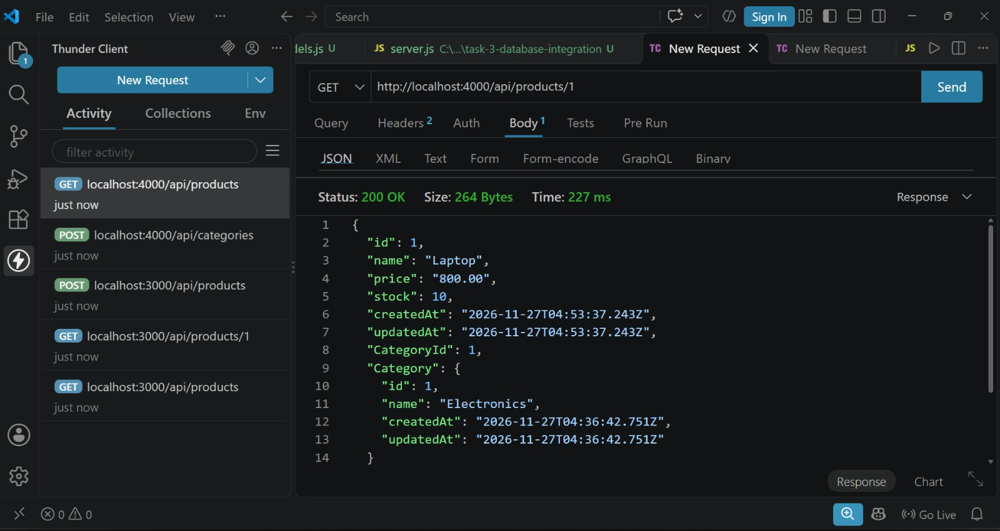

### Update product
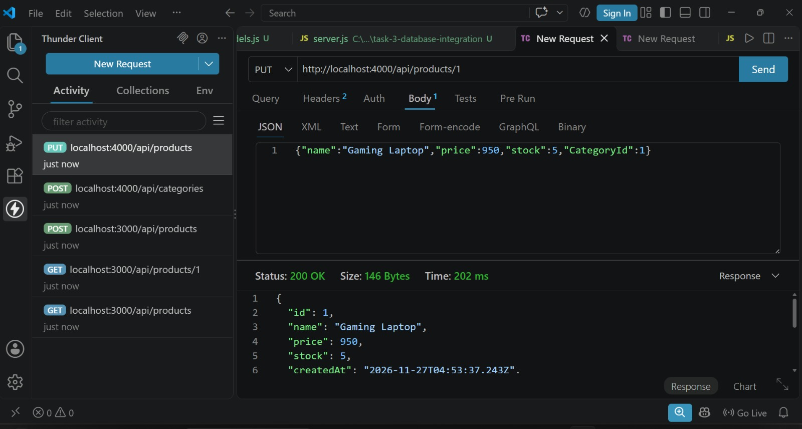

### Delete product
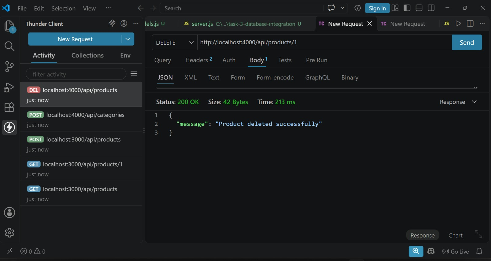

### Validation error (400)
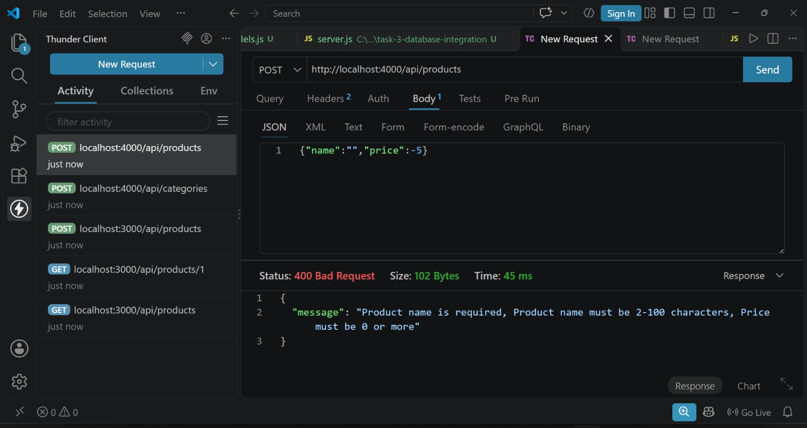

### Invalid category (400)
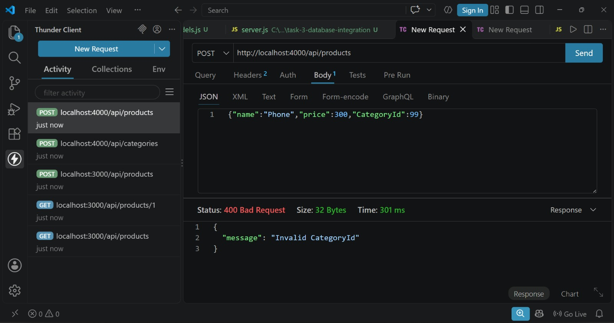

### Not found (404)
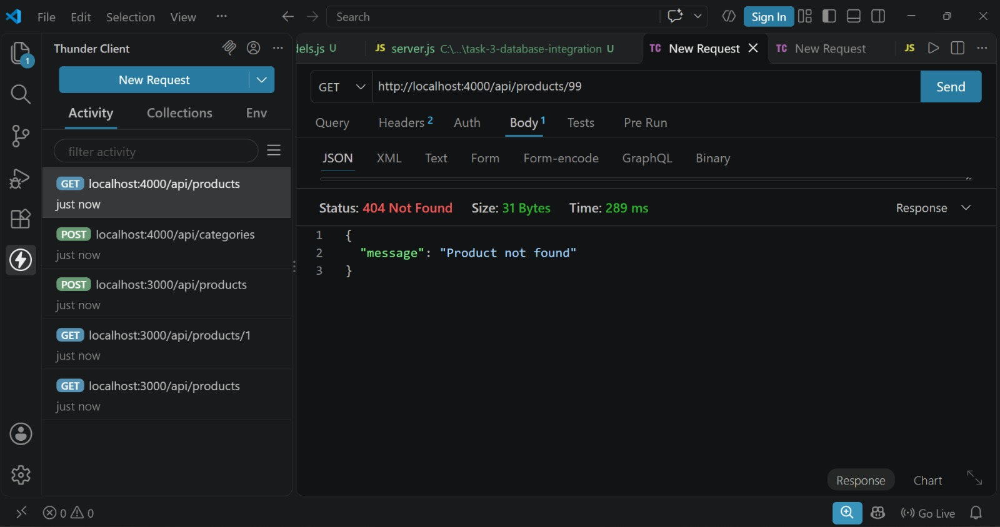